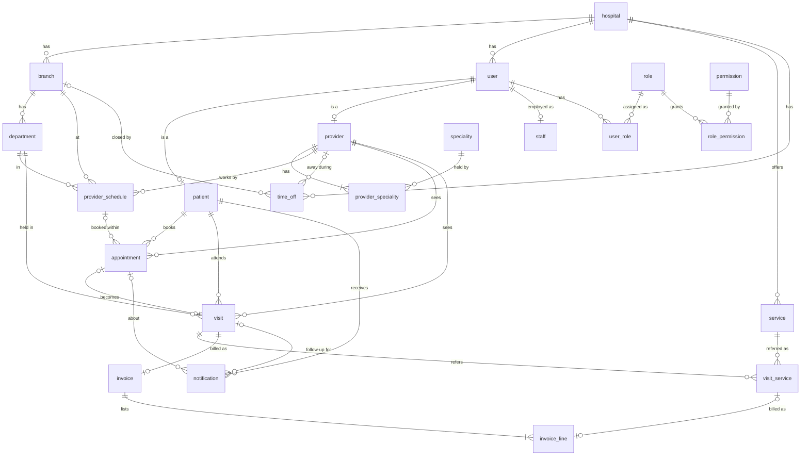
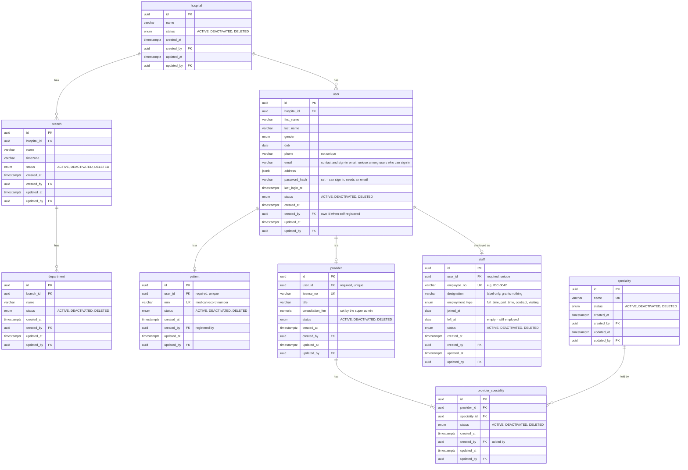
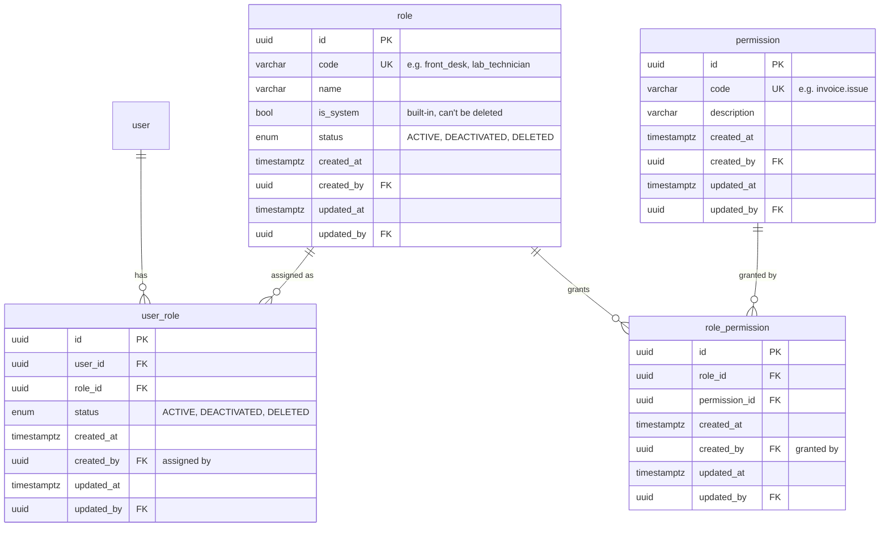
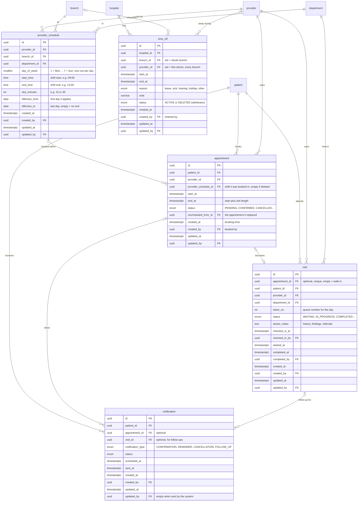
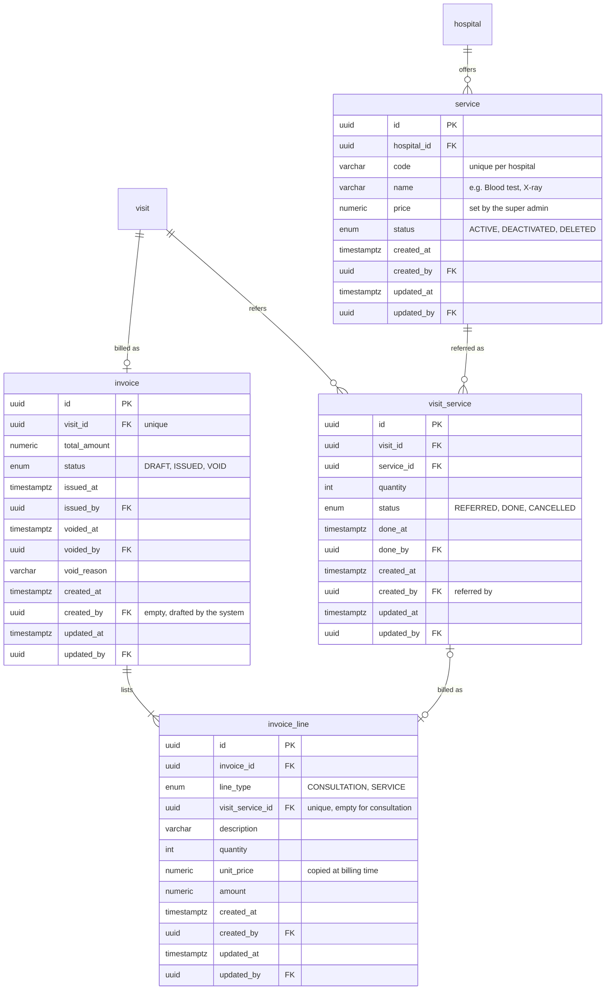

# SmartHealth ERD (step 1, revision 4)

_Data model for the SmartHealth assignment (Part A). Step 1, revision 4: core tables, relationships, record status, roles and traceability columns. Business columns, constraints and the audit/event tables follow in steps 2 and 3._

MediNova · SmartHealth Part A · ERD step 1

## SmartHealth data model

Step 1: the core tables, how they relate, and the columns that record who created and changed each row. Statuses, constraints and the remaining business columns come in the next steps.

- **22** tables
- **34** relationships
- **13** with a record status
- **2** hard-deleted
- **5** built-in roles
- **1** super admin

### Line endings

- Exactly one `||`

- Zero or one `o|`

- One or many `|{`

- Zero or many `o{`

### How to read it

Read each line as a sentence in both directions. `patient` books `appointment`: one patient has zero or many appointments, and each appointment has exactly one patient.

- `PK` primary key, `FK` foreign key, `UK` unique.
- Every column ending in `_by` points to `user`. Those lines aren't drawn; there would be about 50 of them.
- `created_by` and `updated_by` are empty when a background job made the change.
- A box with no columns is shown in full in another diagram.

### What changed in this version

Revision 4 · 22 tables · 34 relationships

- **No separate login email:** `user.login_email` is removed. People sign in with the `email` already on their user row and their password.
- **Email uniqueness:** `email` is unique among users who can sign in (those with a `password_hash`). Patients registered at the front desk without a password can still share an email, for example a parent and child.
- **Who can sign in:** a user with both an `email` and a `password_hash`. The database rejects a password without an email.
- **Revision 3, for reference:** one super admin and no branch admins; roles apply to the whole hospital (`user_role.branch_id` removed); one user can hold several roles, such as provider and front desk.
- **Revision 2, for reference:** first and last name, record `status` instead of `is_deleted`, hard delete for `provider_schedule` and `role_permission`, one schedule row per day, `joined_at` and `left_at`, and the role switcher.

### Overview

22 tables · relationships only

A hospital has branches, and branches have departments. Everyone is one user row with their contact details; signing in, a staff record, a patient record and a provider record are optional layers on top. Doctors work in departments through their schedules, minus any time off. A patient either books an appointment inside a schedule or walks in; either way the doctor sees them in a visit. In the visit the doctor writes notes and refers services, and the visit is billed with one invoice.

All tables

The columns for each table are in the four diagrams below.

### Tables and columns

4 diagrams · keys, essentials and traceability columns

The same model split into four areas so each box is readable. Every table ends with its traceability columns. The 13 tables with a record status have a `status` column just before them; `provider_schedule` and `role_permission` are hard deleted and have none.

Hospital and people

Every user belongs to the hospital. People sign in with their email and password; a user without a password can't sign in, like a patient registered at the front desk.

Roles and permissions

The super admin manages roles, their permissions and who holds them. Roles apply to the whole hospital, and one user can hold several. Taking a permission away from a role deletes its `role_permission` row.

Schedules, time off, appointments, visits and notifications

A visit stores its own patient, doctor and department because a walk-in has no appointment to take them from.

Services and billing

Each invoice line copies the price at billing time, so a later change to a fee or price never changes a past invoice.

### People, logins and profiles

user · staff · patient · provider · user_role

Everyone in the system is one `user` row with their first and last name, date of birth and contact details. Signing in is optional: a user with an email and a password can sign in with them, one without a password can't. A staff record, a patient record and a provider record are optional layers on top of that one row.

| Table | Holds | Who has one |
|---|---|---|
| user | First and last name, gender, date of birth, phone, email, address; plus a password for people who sign in with that email | Everyone: patients, doctors and staff |
| staff | Employee number, designation, employment type, joining and leaving dates | Every employee, doctors included |
| patient | Medical record number, and later medical details | Patients |
| provider | License, title, consultation fee, plus specialities and schedules | Doctors |
| user_role | One role the user holds; a user can have several | Every user who signs in |

#### How each kind of person is stored

| Who | user | Signs in | staff | patient | provider | user_role |
|---|---|---|---|---|---|---|
| Walk-in patient with no login | yes | no | — | yes | — | none |
| Patient who signs up online | yes | yes | — | yes | — | patient |
| Employed doctor | yes | yes | yes | — | yes | provider |
| Front desk, lab technician | yes | yes | yes | — | — | their role |
| Super admin | yes | yes | yes | — | — | super_admin |
| Doctor who also covers the front desk | 1 row | yes | yes | — | yes | provider, front_desk |
| Doctor who is also a patient | 1 row | yes | yes | yes | yes | provider, patient |
| Guest doctor not on the staff list | yes | yes | — | — | yes | provider |

#### Rules

- One `user` row per human. A doctor who is also a patient has one phone number and one address, shared by both records.
- People sign in with their `email` and password; there is no separate login email. A user can sign in only when `email` and `password_hash` are both set, and the database rejects a password without an email.
- `email` is unique among users who can sign in. A sign-up or a new password is refused if another user who can sign in already uses that email.
- `password_hash` is read only by the sign-in code and is never returned by any API, screen or report.
- Only users who can sign in get roles. A provider must be able to sign in; this is checked when the provider is created.
- Phone isn't unique, and neither is email for people who don't sign in, so family members registered at the front desk can share them. Only one person per email can sign in. Duplicate patients are caught at registration by matching name, date of birth and phone.
- If a patient registered at the front desk signs up later, a password is added to their existing user row, matched by phone or medical record number, instead of creating a second one. Their email is filled in or confirmed at the same time, and must not already be used by someone who signs in.
- Every employee, doctors included, has one `staff` row with a unique employee number. A doctor's staff row holds their employment details; their provider row holds the clinical ones.
- `designation` is a label, such as Senior Lab Technician. What someone can do comes only from their roles.
- When someone leaves, the super admin sets `left_at`, sets the staff row to `DEACTIVATED` and sets their `user_role` rows to `DELETED`, so they can no longer act. Their staff row and everything they did stays.
- A user whose status is `DEACTIVATED` can't sign in. Their patient, staff and provider records, and everything they did, stay.

### Schedules, time off and free times

Two tables: provider_schedule and time_off

The super admin enters each doctor's working days and any time off. Free times come from those rows, minus time off and appointments already booked. There's no slot table; free times are calculated when someone looks.

#### Schedules: one row per day and shift

| Doctor | Day | Hours | Where | Slot | Valid from | Valid to |
|---|---|---|---|---|---|---|
| Dr. Lee | Mon (1) | 9:00–13:00 | North, Cardiology | 15 min | 2026-01-01 | No end |
| Dr. Lee | Mon (1) | 17:00–19:00 | North, Cardiology | 15 min | 2026-01-01 | No end |
| Dr. Lee | Tue (2) | 9:00–13:00 | North, Cardiology | 15 min | 2026-01-01 | No end |
| Dr. Lee | Tue (2) | 17:00–19:00 | North, Cardiology | 15 min | 2026-01-01 | No end |
| Dr. Lee | The same two rows for Wednesday, Thursday and Friday: 10 rows for his week |  |  |  |  |  |
| Dr. Khan | Mon (1) | 14:00–17:00 | South, Orthopedics | 30 min | 2026-10-01 | 2026-10-31 |
| Dr. Khan | Wed (3) | 14:00–17:00 | South, Orthopedics | 30 min | 2026-10-01 | 2026-10-31 |
| Dr. Khan | Sat (6) | 9:00–12:00 | South, Orthopedics | 30 min | 2026-10-17 | 2026-10-17 |

- Each row is one shift on one weekday: `day_of_week` (ISO numbers, 1 = Monday to 7 = Sunday), the start and end time, the branch and department, and the slot length. A doctor who works mornings and evenings has two rows for that day, like Dr. Lee's Monday.
- Working Monday to Friday means five rows per shift. The admin screen can still let the admin tick several days at once and saves one row per day, so each day can later be changed or removed on its own, for example a shorter Friday.
- `effective_from` and `effective_to` are the dates a row applies, both inclusive; an empty end date means no limit. A one-off extra shift, like Dr. Khan's Saturday, is a row that starts and ends on the same date.
- Two rows for the same doctor can't be on the same day with overlapping hours and overlapping dates, even at different branches. With one day per row this becomes a database constraint in step 2.
- To change hours from a date, the admin picks "change from". The system ends the affected rows the day before and adds new ones. Appointments keep pointing to the row they were booked in.
- Removing a shift deletes its row for good; schedule rows have no status. Appointments booked in it keep their times and lose the link (`provider_schedule_id` becomes empty), and future ones appear on the "needs rescheduling" list. The step 3 audit log records who deleted it.

#### Time off: one table for leave and closures

| What happens | Doctor | Branch | From → to |
|---|---|---|---|
| Dr. Lee can't take one slot | Dr. Lee | empty | 10 Nov 10:00 → 10:15 |
| Dr. Lee misses the evening shift | Dr. Lee | empty | 10 Nov 17:00 → 19:00 |
| Dr. Lee is on leave for a week | Dr. Lee | empty | 21 Dec 00:00 → 28 Dec 00:00 |
| North branch is closed for a day | empty | North | 25 Dec 00:00 → 26 Dec 00:00 |
| The whole hospital is closed | empty | empty | 1 Jan 00:00 → 2 Jan 00:00 |

- Who is blocked depends on what's filled in: a doctor (at every branch), a branch (every doctor there), or neither (the whole hospital). A row can't name both a doctor and a branch.
- The super admin enters all time off: a doctor's leave, a branch closure or a hospital-wide closure.
- On screen the admin picks "this slot", "these hours" or "these days"; a whole day is midnight to midnight in the branch's timezone.
- Withdrawing time off sets its `status` to `DELETED`; `updated_by` shows who withdrew it.

#### How free times are found

- Take the doctor's schedule rows that are valid on that date and whose `day_of_week` is that weekday.
- Cut each row into slots of its own length: Dr. Lee's Monday gives 9:00, 9:15 … 12:45 and 17:00, 17:15 … 18:45.
- Remove slots that overlap time off for that doctor, that branch or the whole hospital, or an active appointment for that doctor.
- Remove slots already in the past. What's left is shown as free.

#### When someone books

- Steps 1 and 3 are checked again in the same transaction, after locking the doctor's row, so time off and a booking saved at the same moment can't both go through.
- The database rejects a second appointment that overlaps an active one for the same doctor. That constraint is added in step 2.
- A pending appointment holds its time while the booking finishes. This is what "reserving the slot" means now.
- Changing a doctor's slot length only affects new bookings. Existing appointments keep the times they were booked with.

#### Appointments already booked when time off is added

- The super admin adds time off, or ends or deletes a schedule row.
- The affected appointments appear straight away in the front desk's "needs rescheduling" list. Nothing is written to the appointments themselves.
- The front desk contacts each patient, then reschedules (a new appointment whose `rescheduled_from_id` points to the old one, which is marked rescheduled) or cancels it.
- If the time off is withdrawn first, those appointments drop off the list by themselves.

- The list is a query: future pending or confirmed appointments that overlap time off that applies to them, or whose schedule row has ended before the appointment date or was deleted (`provider_schedule_id` is empty).
- The reason, who caused it and when come from the time off row (`reason`, `created_by`, `created_at`) or the schedule row (`effective_to`, `updated_by`). For a deleted row they come from the step 3 audit log.

### Walk-in visits

A visit with no appointment

Every patient the doctor sees has a visit. Booked patients get one when they check in, linked to their appointment. A walk-in's visit has an empty `appointment_id`.

#### What happens

- The patient arrives without an appointment, and the doctor's slots are all booked.
- The front desk finds the patient, or registers them: a `user` row without a login, and a `patient` row.
- The front desk creates a visit for a chosen doctor and department, with the next token number. Status is waiting.
- The doctor sees booked patients first, then walk-ins in token order.
- The doctor writes `doctor_notes` (history, findings), refers any services, and completes the visit.

#### Rules

- `token_no` is unique per doctor per day.
- One visit per appointment: `appointment_id` is unique when it's filled in.
- Only roles with the permission to read doctor's notes can see them, so the front desk doesn't.

### Billing a visit

Doctor's fee plus the services the patient took

One invoice per visit. It starts as a draft when the doctor completes the visit, gains a line for each service as it's done, and the front desk issues it at checkout.

#### What happens

- When the doctor completes the visit, the billing worker creates a draft invoice with one consultation line at the doctor's current fee.
- The doctor's referred services start as referred. When the lab technician marks one done, a service line is added at that service's current price. Cancelled services are never billed.
- At checkout the front desk issues the invoice. It can only be issued once every referred service is done or cancelled.

#### Example invoice

| Line | Qty | Price | Amount |
|---|---|---|---|
| Consultation, Dr. Lee | 1 | 2,000 | 2,000 |
| Blood test | 1 | 800 | 800 |
| X-ray | 1 | 1,500 | 1,500 |
| Total |  |  | 4,300 |

#### Rules

- Doctor fees and service prices are set once per hospital by the super admin.
- Lines copy the price at billing time, so later price changes don't affect past invoices.
- A service appears on at most one invoice line (`visit_service_id` is unique on the line).
- Payments and refunds are not part of this iteration.

### Roles and permissions

5 built-in roles · 1 super admin · roles apply to the whole hospital

A permission is one thing the system lets you do, like issuing an invoice. A role is a named bundle of permissions. A user who can sign in gets one or more roles through `user_role`. Roles aren't tied to a branch: each one applies across the hospital.

#### The roles

| Role | Code | Who | Main job |
|---|---|---|---|
| Super admin | `super_admin` | Exactly one person | Sets up and runs the whole hospital: settings, branches, departments, specialities, doctors and staff, services and prices, schedules, time off and closures, roles and who holds them. |
| Front desk | `front_desk` | Front desk staff, at any branch | Registers patients, books and reschedules appointments, checks patients in, handles walk-ins, issues invoices. |
| Provider | `provider` | Doctors | Sees patients: works through the queue, writes notes, refers services, completes visits. Their branches come from their schedule. |
| Lab technician | `lab_technician` | Lab and imaging staff, at any branch | Performs referred services such as blood tests and X-rays, and marks them done so they're added to the invoice. |
| Patient | `patient` | Anyone who signs up | Books and manages their own appointments, and sees their own visits and invoices. Patients belong to the hospital and can visit any branch. |

#### Who holds which role (example)

| Person | Roles | Where they work |
|---|---|---|
| Bilal | `super_admin` | The whole hospital |
| Sara, Omar, Zara | `front_desk` | Any branch; usually Sara and Omar at North, Zara at South |
| Imran, Hina | `lab_technician` | Any branch |
| Dr. Lee | `provider`, `front_desk` | Sees patients at North through his schedule, and covers the front desk when it's short-staffed |
| Dr. Khan | `provider` | South, through his schedule |
| Any patient | `patient` if they sign up | Can visit either branch |

#### What each role can do

| Action | Super admin | Front desk | Provider | Lab technician | Patient |
|---|---|---|---|---|---|
| Hospital setup |  |  |  |  |  |
| Edit hospital settings | Yes | — | — | — | — |
| Create and manage branches and departments | Yes | — | — | — | — |
| Add and manage specialities | Yes | — | — | — | — |
| Manage services, prices and doctor fees | Yes | — | — | — | — |
| Register doctors and staff | Yes | — | — | — | — |
| Create roles and choose their permissions | Yes | — | — | — | — |
| Give roles to people | Yes | — | — | — | — |
| Schedules and time off |  |  |  |  |  |
| Enter doctors' schedules and time off | Yes | — | — | — | — |
| Close a branch, or the whole hospital | Yes | — | — | — | — |
| See doctors' schedules | Yes | Yes | Own | — | Free times only |
| Patients and appointments |  |  |  |  |  |
| Register patients | Yes | Yes | — | — | Sign up |
| Book, cancel and reschedule appointments | Yes | Yes | — | — | Own |
| Work the "needs rescheduling" list | Yes | Yes | — | — | — |
| See appointments and visits | Yes | Yes | Own | — | Own |
| Visits and services |  |  |  |  |  |
| Check in patients, create walk-in visits | Yes | Yes | — | — | — |
| See the waiting queue | Yes | Yes | Own | — | — |
| Write and read doctor's notes | — | — | Own visits | — | — |
| Refer services, complete the visit | — | — | Own visits | — | — |
| Mark referred services done or cancelled | — | — | — | Yes | — |
| Billing and reports |  |  |  |  |  |
| Issue invoices | Yes | Yes | — | — | — |
| Void invoices | Yes | — | — | — | — |
| See invoices | Yes | Yes | — | — | Own |
| See analytics | Yes | — | — | — | — |
| Everyone |  |  |  |  |  |
| Update their own contact details | Own | Own | Own | Own | Own |

Yes = anywhere in the hospital · Own = only their own records or visits · — = not allowed

#### Switching roles

One user can hold several roles. The app shows a role switcher in its header; each entry is one of the user's active `user_role` rows, and choosing one opens that role's views with that role's permissions.

| Dr. Lee picks | Role | Opens |
|---|---|---|
| Provider | `provider` | His queue, visits, notes and referrals |
| Front desk | `front_desk` | Registration, booking, check-in, walk-ins and invoices |

- The app works as one role at a time. The API checks the permissions of the active role only, not every role the user holds combined. While Dr. Lee works as front desk he can't open doctor's notes, and while he works as provider he can't issue invoices.
- The active role belongs to the session: the client sends the chosen `user_role` id with each request, and the server checks that the row belongs to the signed-in user and is `ACTIVE` before using it. Nothing new is stored in the database.
- Switching opens that role's home view without signing out. A user with only one role sees no switcher.
- A role assignment that is `DEACTIVATED` or `DELETED` leaves the switcher, and requests made with it are refused, so the app asks the user to pick another role.
- The step 3 audit log records which role the user was acting as for each change.

#### Rules

- The five built-in roles (`super_admin`, `front_desk`, `provider`, `lab_technician`, `patient`) are created at install (`is_system`) and can't be deactivated or deleted. A deactivated custom role can't be given to anyone, and people who hold it can't switch to it.
- There is exactly one super admin. Only one active `user_role` row can hold `super_admin`; a unique index enforces this in step 2. Handing the role over gives it to the new person and takes it from the old one in a single step, so the hospital is never without one.
- Only the super admin gives roles to people or takes them away, so nobody can make themselves more powerful.
- The super admin can add custom roles, such as nurse or billing clerk, and change which permissions any role has. Taking a permission away deletes that `role_permission` row. The super admin role always keeps every permission, so nobody can lock the hospital out of its own system.
- Roles aren't tied to a branch. Front desk and lab staff can work at any branch, a doctor's branches come from their schedule, and patients can visit any branch.
- Clinical work stays with clinical roles: the super admin can't write doctor's notes, refer services or mark services done, unless that person also holds the matching role and switches to it.
- Permissions are a fixed list in the code, because the code is what checks them. Roles, their permissions and who holds them are data the super admin manages.
- One user can hold several roles: a doctor who covers the front desk has `provider` and `front_desk`, and a front desk member treated at the hospital adds `patient`. A doctor who is also a patient can't book an appointment with themselves.

### Traceability columns

Who did what, and when

Every row records when it was created and last changed, and by which signed-in user. Deactivating or deleting a row is also a change: it sets `status`, so `updated_at` and `updated_by` show when and by whom. The actions that matter later get their own time and person columns.

| Group | Columns | On which tables |
|---|---|---|
| Created | `created_at`, `created_by` | All 22. `created_by` is empty when a background job created the row. |
| Last updated | `updated_at`, `updated_by` | All 22. On a deactivated or deleted row, this is who did it and when. Empty when a background job made the last change. |
| Record status | `status`: `ACTIVE`, `DEACTIVATED`, `DELETED` | The 13 tables that are switched off rather than removed: hospital, branch, department, user, staff, patient, provider, speciality, provider_speciality, role, user_role, time_off, service |
| Hard delete | none | provider_schedule and role_permission. Removing a row deletes it; the step 3 audit log records who removed it and what it held. |
| Key actions | visit: `checked_in_at`, `checked_in_by`, `started_at`, `completed_at`, `completed_by` visit_service: `done_at`, `done_by` invoice: `issued_at`, `issued_by`, `voided_at`, `voided_by`, `void_reason` notification: `sent_at` | Actions people perform get a time and a person, always filled in. A visit's start needs no person: it's the visit's doctor. Sending a notification is done only by a background job, so it has a time only. |

#### What each status means

| Table | DEACTIVATED | DELETED |
|---|---|---|
| hospital, branch, department | Closed for now: no new schedules or bookings. Past records still point to it. | Created by mistake. Hidden everywhere. |
| user | Can't sign in. Their records stay. | A duplicate or a mistake. Hidden. |
| staff | Has left the hospital (`left_at` is set). | Entered by mistake. |
| patient | Can't book new appointments. Visits and invoices stay. | A duplicate merged into another record. |
| provider | Not taking new appointments. Booked ones stay. | Entered by mistake. |
| speciality, service | No longer offered. Can't be chosen for new work. | Entered by mistake. |
| role | Can't be given to anyone, and holders can't switch to it. | Removed. Built-in roles can be neither deactivated nor deleted. |
| user_role | Paused: hidden from that person's role switcher. | The role is taken away. |
| provider_speciality | Not used. | The speciality is removed from the doctor. |
| time_off | Not used. | The time off is withdrawn. |

New rows start as ACTIVE · a DEACTIVATED row can be made ACTIVE again · DELETED is final in the app

#### Rules

- `created_by` and `updated_by` hold the signed-in user who made the change, taken from the session, never from the request body.
- They're empty when a background job made the change, such as confirming a booking, drafting an invoice or sending a reminder. Which job did it is recorded in the step 3 audit log and in the `trace_id` in logs.
- When someone signs up themselves, their new user id is recorded as the creator of their own user and patient rows.
- A cancelled or rescheduled appointment can't be changed afterwards, so its `updated_by` and `updated_at` stay as who cancelled or moved it, and when.
- A row with status `DELETED` stays in its table and is hidden from normal queries. A `DEACTIVATED` row still shows in admin lists but can't be used for new work. Anything that pointed at either still works, so past visits keep their branch, department, doctor and services.
- `provider_schedule` and `role_permission` rows are deleted outright. Appointments booked in a deleted schedule row keep their own times.
- Unique values (the email of a user who can sign in, employee number, medical record number, license number, a role's code, a service code within a hospital) are unique only among rows whose status isn't `DELETED`. Phone isn't unique at all.
- Appointments, visits, referred services, invoices, invoice lines and notifications are never deleted. They change status instead; their `status` column is their workflow state, such as `CONFIRMED`, not a record status.
- These columns hold the latest change only. The audit log in step 3 keeps every change, with values before and after.

#### Questions these columns answer

| Question | Where the answer is |
|---|---|
| Who booked this appointment, and who cancelled it? | `appointment.created_by`; once the status is cancelled, `updated_by` and `updated_at` |
| Who registered this walk-in? | `patient.created_by`, `visit.created_by`, `checked_in_by` |
| How do I contact Dr. Lee? | `provider.user_id` → `user.phone`, `email` |
| What's this lab technician's employee number, and when did they join? | `staff.employee_no`, `joined_at` |
| Who referred this X-ray, and who did it? | `visit_service.created_by`, `done_by` |
| Was this invoice drafted by a person or by the system? | `invoice.created_by`: empty means the system; the audit log names the job |
| Who issued or voided this invoice? | `invoice.issued_by`, `voided_by` |
| Who gave the front desk role the right to cancel appointments? | `role_permission.created_by` |
| Who gave this user the front desk role, and who took it away? | `user_role.created_by`, and `updated_by` once its status is `DELETED` |
| Who put Dr. Lee on leave, and who withdrew it? | `time_off.created_by`, and `updated_by` once its status is `DELETED` |
| Who changed Dr. Lee's hours, and from when? | The old rows' `updated_by` and `effective_to`, and the new rows' `created_by` and `effective_from` |
| Who removed Dr. Lee's Friday evening shift, or took a permission away from a role? | Those rows are hard deleted, so the step 3 audit log records who did it and what the row held |
| Which appointments need rescheduling? | The "needs rescheduling" query: active appointments that overlap time off, fall outside their schedule's dates, or whose schedule row was deleted |

### Relationships in words

34 relationships

Every line in the overview, written as a plain rule.

| Between | Type | Rule |
|---|---|---|
| Places |  |  |
| hospital → branch | 1 to many | A hospital has many branches. Each branch belongs to one hospital. |
| branch → department | 1 to many | A branch has many departments. Each department belongs to one branch. |
| People |  |  |
| hospital → user | 1 to many | Every user belongs to the hospital. |
| user → patient | 1 to 0/1 | A user has at most one patient record, and every patient is one user. A patient may have no login. |
| user → provider | 1 to 0/1 | A user has at most one provider record. A provider's user must be able to sign in. |
| user → staff | 1 to 0/1 | An employee has one staff row with their employee number. Patients and doctors who aren't employees have none. |
| provider ↔ speciality | many to many | A provider has one or more specialities, and a speciality is shared by many providers, through `provider_speciality`. |
| Roles and permissions |  |  |
| user → user_role | 1 to 0+ | A user who can sign in has at least one role and can have several, such as provider and front desk. A patient without a login has none. |
| role → user_role | 1 to many | A role is given to many users, except `super_admin`, which exactly one user holds. |
| role ↔ permission | many to many | A role has many permissions, and a permission can be in many roles, through `role_permission`. Taking a permission away deletes the row. |
| Schedules, time off and appointments |  |  |
| provider → provider_schedule | 1 to many | A provider has many schedule rows, one per day and shift: Monday 9:00–13:00 and Monday 17:00–19:00 are two rows. |
| branch, department → provider_schedule | 1 to many | Each schedule row says where the provider works in that time, so one provider can work at several branches and departments. |
| hospital → time_off | 1 to many | Every time off row belongs to a hospital. With no doctor and no branch, it closes the whole hospital. |
| branch → time_off | 0/1 to many | Time off for a branch blocks every doctor there. |
| provider → time_off | 0/1 to many | Time off for a doctor blocks them at every branch. |
| provider_schedule → appointment | 0/1 to many | Each appointment is booked inside one schedule row and takes that row's slot length. If the row is later deleted, the link is cleared and the appointment keeps its times. |
| patient → appointment | 1 to many | A patient books many appointments. Each appointment is for one patient. |
| provider → appointment | 1 to many | Stored on the appointment so the database can reject two overlapping appointments for the same doctor. |
| Visits |  |  |
| appointment → visit | 0/1 to 0/1 | A booked appointment becomes at most one visit. A walk-in visit has no appointment. |
| patient, provider, department → visit | 1 to many | Stored on the visit itself, because a walk-in has no appointment to take them from. |
| Services and billing |  |  |
| hospital → service | 1 to many | Each hospital has its own list of services and prices. |
| visit → visit_service | 1 to many | The doctor can refer any number of services in a visit. |
| service → visit_service | 1 to many | A service is referred in many visits. |
| visit → invoice | 1 to 0/1 | A visit has at most one invoice. |
| invoice → invoice_line | 1 to 1+ | An invoice has at least the consultation line. |
| visit_service → invoice_line | 0/1 to 0/1 | A service that was done appears on exactly one line. Referred or cancelled services have none. |
| Notifications |  |  |
| patient → notification | 1 to many | A patient receives many notifications, sent to the contact details on their user row. |
| appointment → notification | 0/1 to many | Confirmations, reminders and cancellations are about an appointment. |
| visit → notification | 0/1 to many | Follow-up reminders are about a visit, which also covers walk-ins. |

### Decisions and next steps

What step 1 locks, and what comes next

#### Decided

- Hospital → branches → departments
- One `user` row per human with first name, last name and contact details; signing in is optional, so a patient registered at the front desk needs no password
- People sign in with the email on their user row; there is no separate login email
- Staff, patient and provider records link to the user; a doctor who is also a patient is one user with both records
- Every employee, doctors included, has a staff row: employee number, designation, employment type, `joined_at` and `left_at`
- A provider can have many specialities
- No slot table: free times are calculated from the doctor's schedule, and slot length is set per schedule row
- One schedule row per day and shift, each with its own start and end time, a valid-from date and an optional valid-to date
- Providers work at several branches and departments through their schedules
- One time off table for a doctor, a branch or the whole hospital; a doctor's time off blocks them at every branch
- The super admin enters schedules and time off
- Appointments hit by time off are listed for the front desk to reschedule, not cancelled; the list is calculated, not stored
- Walk-ins are visits without an appointment, for a chosen doctor, seen after booked patients
- Doctor's notes are stored on the visit
- Invoice per visit: doctor's fee plus the services the patient took, issued at checkout
- Doctor fees and service prices are set per hospital by the super admin
- Five built-in roles: super admin (exactly one person, runs every admin setting), front desk, provider, lab technician and patient. There are no branch admins. The super admin manages roles; permissions are fixed in code
- Roles apply to the whole hospital; they aren't limited to a branch or department
- Created and updated columns on every table, empty when a background job made the change
- A record status (`ACTIVE`, `DEACTIVATED`, `DELETED`) on 13 tables instead of a delete flag; `provider_schedule` and `role_permission` are hard deleted
- One user can hold several roles, such as provider and front desk, and works as one at a time through a role switcher; the API checks the active role's permissions
- Columns that record when something happened end in `_at`

#### Assumed, please confirm

- Every provider has at least one speciality
- Each user belongs to one hospital
- Specialities are one shared list, not set per hospital
- Booked patients and walk-ins pay the same consultation fee
- An invoice can be issued only when every referred service is done or cancelled

#### Step 2: columns and constraints

- Full business columns and statuses for each table
- No overlapping active appointments per doctor, and how long a pending booking can hold its time
- No overlapping schedule rows for the same doctor: same day, overlapping hours and overlapping dates
- Unique keys and safe retries, including only one active `super_admin`

#### Step 3: requirement-driven tables

- Audit log with every change, its before and after values, and whether a person or which background job made it
- Event tables for reliable, non-duplicated processing
- Appointment status history for the cancellation rate
- Billing pre-check at booking, and daily metrics for analytics
