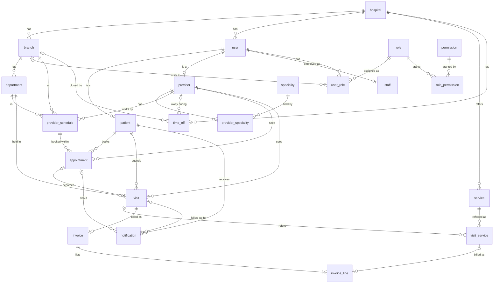
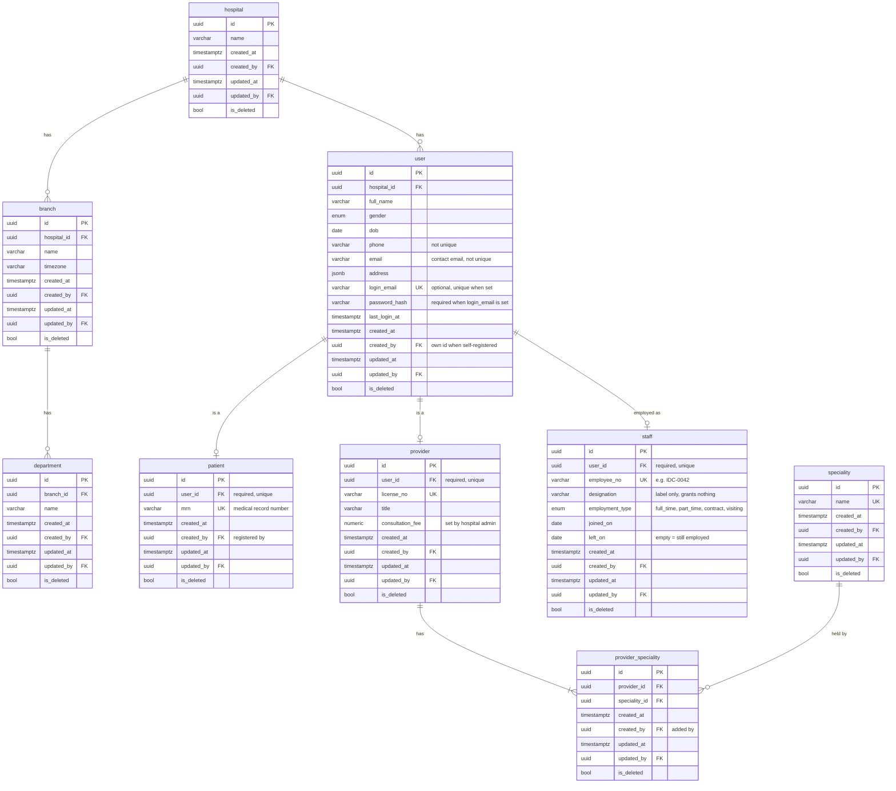
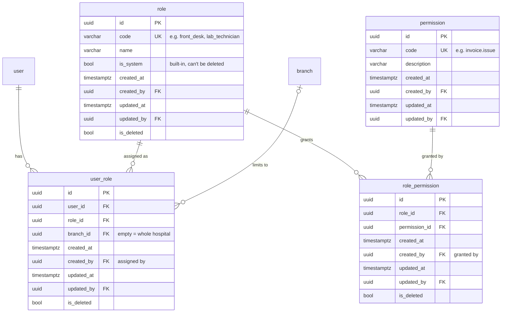
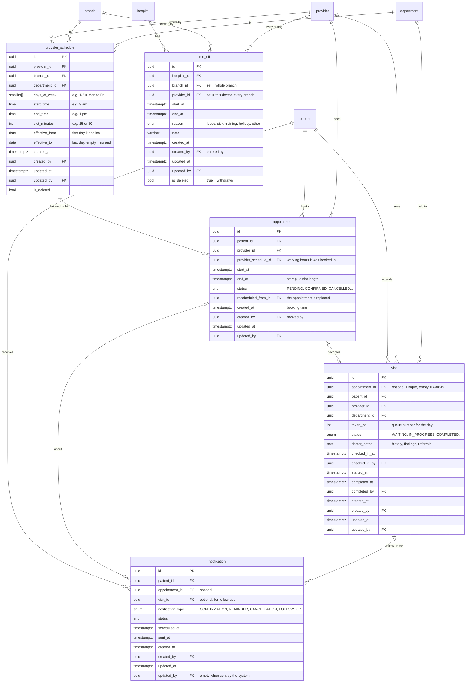
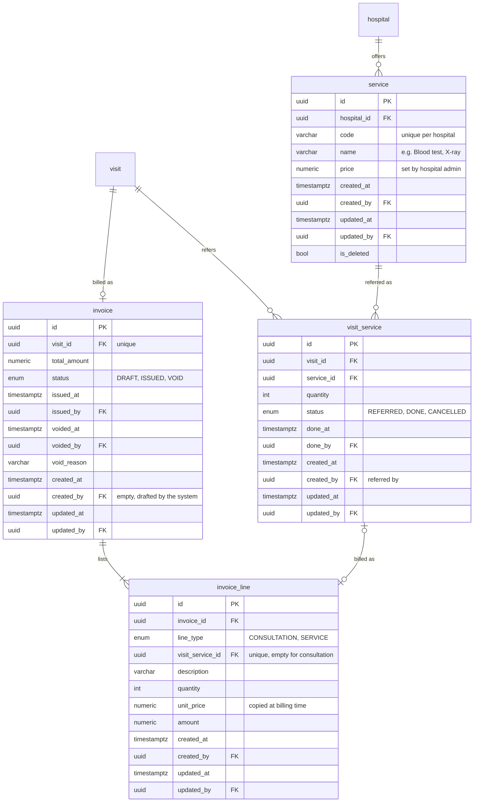

# SmartHealth ERD (step 1)

_Data model for the SmartHealth assignment (Part A). Currently step 1: core tables, relationships and traceability columns. Statuses, constraints and the audit/event tables follow in steps 2 and 3._

MediNova · SmartHealth Part A · ERD step 1

## SmartHealth data model

Step 1: the core tables, how they relate, and the columns that record who created and changed each row. Statuses, constraints and the remaining business columns come in the next steps.

- **22** tables
- **35** relationships
- **15** can be deleted
- **5** built-in roles

### Line endings

- Exactly one `||`
- Zero or one `o|`
- One or many `|{`
- Zero or many `o{`

### How to read it

Read each line as a sentence in both directions. `patient` books `appointment`: one patient has zero or many appointments, and each appointment has exactly one patient.

- `PK` primary key, `FK` foreign key, `UK` unique.
- Every column ending in `_by` points to `user`. Those lines aren't drawn; there would be about 50 of them.
- `created_by` and `updated_by` are empty when a background job made the change.
- A box with no columns is shown in full in another diagram.

### What changed in this version

Appointment columns · still 22 tables

- **No separate cancellation columns:** `cancelled_at`, `cancelled_by` and `cancel_reason` are removed from `appointment`.
- **Who cancelled, and when,** come from the last update: the status becomes cancelled, and `updated_by` and `updated_at` record the change. A cancelled appointment can't be changed afterwards, so those values stay.
- **No cancellation reason for now.** The step 3 audit log will keep the full history of every appointment.

### Overview

22 tables · relationships only

A hospital has branches, and branches have departments. Everyone is one user row with their contact details; signing in, a staff record, a patient record and a provider record are optional layers on top. Doctors work in departments through their schedules, minus any time off. A patient either books an appointment inside a schedule or walks in; either way the doctor sees them in a visit. In the visit the doctor writes notes and refers services, and the visit is billed with one invoice.

All tablesActual size

The columns for each table are in the four diagrams below.

### Tables and columns

4 diagrams · keys, essentials and traceability columns

The same model split into four areas so each box is readable. Every table ends with its traceability columns; tables that can be deleted also have `is_deleted`.

Hospital and peopleActual size

Every user belongs to the hospital. A user without a login email and password can't sign in, like a patient registered at the front desk.

Roles and permissionsActual size

The hospital admin manages roles and their permissions. A role given to a user can be limited to one branch; with no branch it covers the whole hospital.

Schedules, time off, appointments, visits and notificationsActual size

A visit stores its own patient, doctor and department because a walk-in has no appointment to take them from.

Services and billingActual size

Each invoice line copies the price at billing time, so a later change to a fee or price never changes a past invoice.

### People, logins and profiles

user · staff · patient · provider · user_role

Everyone in the system is one `user` row with their name, date of birth and contact details. Signing in is optional: a user with a login email and password can sign in, one without can't. A staff record, a patient record and a provider record are optional layers on top of that one row.

| Table | Holds | Who has one |
|---|---|---|
| user | Name, gender, date of birth, phone, email, address; plus login email and password for people who sign in | Everyone: patients, doctors and staff |
| staff | Employee number, designation, employment type, joining and leaving dates | Every employee, doctors included |
| patient | Medical record number, and later medical details | Patients |
| provider | License, title, consultation fee, plus specialities and schedules | Doctors |
| user_role | A role and, optionally, a branch | Every user who signs in |

#### How each kind of person is stored

| Who | user | Signs in | staff | patient | provider | user_role |
|---|---|---|---|---|---|---|
| Walk-in patient with no login | yes | no | — | yes | — | none |
| Patient who signs up online | yes | yes | — | yes | — | patient |
| Employed doctor | yes | yes | yes | — | yes | provider |
| Front desk, lab technician, branch admin | yes | yes | yes | — | — | their role, with their branch |
| Hospital admin | yes | yes | yes | — | — | admin, no branch |
| Doctor who is also a patient | 1 row | yes | yes | yes | yes | provider, patient |
| Guest doctor not on the staff list | yes | yes | — | — | yes | provider |

#### Rules

- One `user` row per human. A doctor who is also a patient has one phone number and one address, shared by both records.
- A user can sign in only when `login_email` and `password_hash` are both set; the database rejects a login email without a password. `login_email` is unique among users that have one.
- `password_hash` is read only by the sign-in code and is never returned by any API, screen or report.
- Only users who can sign in get roles. A provider must be able to sign in; this is checked when the provider is created.
- Phone and contact email aren't unique, so family members can share them. Duplicate patients are caught at registration by matching name, date of birth and phone. The login email can differ from the contact email.
- If a patient registered at the front desk signs up later, a login email and password are added to their existing user row, matched by phone or medical record number, instead of creating a second one.
- Every employee, doctors included, has one `staff` row with a unique employee number. A doctor's staff row holds their employment details; their provider row holds the clinical ones.
- `designation` is a label, such as Senior Lab Technician. What someone can do comes only from their roles.
- When someone leaves, the admin sets `left_on` and removes their roles, so they can no longer act. Their staff row and everything they did stays.

### Schedules, time off and free times

Two tables: provider_schedule and time_off

The branch admin enters each doctor's working pattern and any time off. Free times come from the pattern, minus time off and appointments already booked. There's no slot table; free times are calculated when someone looks.

#### Schedules: one row per working pattern

| Doctor | Days | Hours | Where | Slot | Valid from | Valid to |
|---|---|---|---|---|---|---|
| Dr. Lee | Mon–Fri | 9:00–13:00 | North, Cardiology | 15 min | 2026-01-01 | No end |
| Dr. Lee | Mon–Fri | 17:00–19:00 | North, Cardiology | 15 min | 2026-01-01 | No end |
| Dr. Khan | Mon, Wed | 14:00–17:00 | South, Orthopedics | 30 min | 2026-10-01 | 2026-10-31 |
| Dr. Khan | Sat | 9:00–12:00 | South, Orthopedics | 30 min | 2026-10-17 | 2026-10-17 |

- Each row is a pattern: the weekdays it repeats on (ISO numbers, 1 = Monday to 7 = Sunday), the daily hours, the branch and department, and the slot length. A doctor can have several rows on the same day, like Dr. Lee's morning and evening shifts.
- `effective_from` and `effective_to` are the dates the pattern applies, both inclusive; an empty end date means no limit. A one-off extra shift, like Dr. Khan's Saturday, is a row that starts and ends on the same day.
- Two rows for the same doctor can't overlap (a shared weekday, overlapping hours and overlapping dates), even at different branches. This is checked when the row is saved.
- To change hours from a date, the admin picks "change from". The system ends the current row the day before and adds a new one. Appointments keep pointing to the row they were booked in.

#### Time off: one table for leave and closures

| What happens | Doctor | Branch | From → to |
|---|---|---|---|
| Dr. Lee can't take one slot | Dr. Lee | empty | 10 Nov 10:00 → 10:15 |
| Dr. Lee misses the evening shift | Dr. Lee | empty | 10 Nov 17:00 → 19:00 |
| Dr. Lee is on leave for a week | Dr. Lee | empty | 21 Dec 00:00 → 28 Dec 00:00 |
| North branch is closed for a day | empty | North | 25 Dec 00:00 → 26 Dec 00:00 |
| The whole hospital is closed | empty | empty | 1 Jan 00:00 → 2 Jan 00:00 |

- Who is blocked depends on what's filled in: a doctor (at every branch), a branch (every doctor there), or neither (the whole hospital). A row can't name both a doctor and a branch.
- Branch admins enter time off for doctors who work in their branch and for their own branch. Hospital admins can enter any, including hospital-wide closures.
- On screen the admin picks "this slot", "these hours" or "these days"; a whole day is midnight to midnight in the branch's timezone.
- Withdrawing time off sets `is_deleted`; `updated_by` shows who withdrew it.

#### How free times are found

- Take the doctor's schedule rows that are valid on that date and include that weekday.
- Cut each row into slots of its own length: Dr. Lee's Monday gives 9:00, 9:15 … 12:45 and 17:00, 17:15 … 18:45.
- Remove slots that overlap time off for that doctor, that branch or the whole hospital, or an active appointment for that doctor.
- Remove slots already in the past. What's left is shown as free.

#### When someone books

- Steps 1 and 3 are checked again in the same transaction, after locking the doctor's row, so time off and a booking saved at the same moment can't both go through.
- The database rejects a second appointment that overlaps an active one for the same doctor. That constraint is added in step 2.
- A pending appointment holds its time while the booking finishes. This is what "reserving the slot" means now.
- Changing a doctor's slot length only affects new bookings. Existing appointments keep the times they were booked with.

#### Appointments already booked when time off is added

- A branch admin adds time off, or ends a schedule early.
- The affected appointments appear straight away in the front desk's "needs rescheduling" list. Nothing is written to the appointments themselves.
- The front desk contacts each patient, then reschedules (a new appointment whose `rescheduled_from_id` points to the old one, which is marked rescheduled) or cancels it.
- If the time off is withdrawn first, those appointments drop off the list by themselves.
- The list is a query: future pending or confirmed appointments that overlap time off that applies to them, or whose schedule row has ended or been deleted before the appointment date.
- The reason, who caused it and when come from the time off row (`reason`, `created_by`, `created_at`) or the schedule row (`effective_to`, `updated_by`).

### Walk-in visits

A visit with no appointment

Every patient the doctor sees has a visit. Booked patients get one when they check in, linked to their appointment. A walk-in's visit has an empty `appointment_id`.

#### What happens

- The patient arrives without an appointment, and the doctor's slots are all booked.
- The front desk finds the patient, or registers them: a `user` row without a login, and a `patient` row.
- The front desk creates a visit for a chosen doctor and department, with the next token number. Status is waiting.
- The doctor sees booked patients first, then walk-ins in token order.
- The doctor writes `doctor_notes` (history, findings), refers any services, and completes the visit.

#### Rules

- `token_no` is unique per doctor per day.
- One visit per appointment: `appointment_id` is unique when it's filled in.
- Only roles with the permission to read doctor's notes can see them, so the front desk doesn't.

### Billing a visit

Doctor's fee plus the services the patient took

One invoice per visit. It starts as a draft when the doctor completes the visit, gains a line for each service as it's done, and the front desk issues it at checkout.

#### What happens

- When the doctor completes the visit, the billing worker creates a draft invoice with one consultation line at the doctor's current fee.
- The doctor's referred services start as referred. When the lab technician marks one done, a service line is added at that service's current price. Cancelled services are never billed.
- At checkout the front desk issues the invoice. It can only be issued once every referred service is done or cancelled.

#### Example invoice

| Line | Qty | Price | Amount |
|---|---|---|---|
| Consultation, Dr. Lee | 1 | 2,000 | 2,000 |
| Blood test | 1 | 800 | 800 |
| X-ray | 1 | 1,500 | 1,500 |
| Total |  |  | 4,300 |

#### Rules

- Doctor fees and service prices are set once per hospital by the hospital admin. Branch admins can't change them.
- Lines copy the price at billing time, so later price changes don't affect past invoices.
- A service appears on at most one invoice line (`visit_service_id` is unique on the line).
- Payments and refunds are not part of this iteration.

### Roles and permissions

5 built-in roles · managed by the hospital admin

A permission is one thing the system lets you do, like issuing an invoice. A role is a named bundle of permissions. A user who can sign in gets a role through `user_role`, either for the whole hospital or for one branch.

#### The roles

| Role | Given as | Who | Main job |
|---|---|---|---|
| Hospital admin | admin, no branch | The super admin, usually one or two people | Sets up and runs the whole hospital: settings, branches, departments, doctors, services and prices, roles and permissions. |
| Branch admin | admin, one branch | At least one per branch | Runs a branch: its front desk and lab staff, doctors' schedules and time off there, and branch closures. |
| Front desk | front_desk, one branch | Several per branch | Registers patients, books and reschedules appointments, checks patients in, handles walk-ins, issues invoices. |
| Provider | provider, no branch | Doctors | Sees patients: works through the queue, writes notes, refers services, completes visits. Their branches come from their schedule. |
| Lab technician | lab_technician, one branch | Lab and imaging staff in each branch | Performs referred services such as blood tests and X-rays, and marks them done so they're added to the invoice. |
| Patient | patient, no branch | Anyone who signs up | Books and manages their own appointments, and sees their own visits and invoices. Patients belong to the hospital and can visit any branch. |

#### How the branches are staffed

| Role | North branch | South branch |
|---|---|---|
| Hospital admin | Bilal, for the whole hospital (admin, no branch) |  |
| Branch admin | Ahmed (admin @ North) | Sana (admin @ South) |
| Front desk | Sara, Omar | Zara |
| Lab technician | Imran | Hina |
| Provider | Dr. Lee, through his North schedule | Dr. Khan, through his South schedule |
| Patient | Any patient of the hospital can visit either branch |  |

#### What each role can do

| Action | Hospital admin | Branch admin | Front desk | Provider | Lab technician | Patient |
|---|---|---|---|---|---|---|
| Hospital setup |  |  |  |  |  |  |
| Edit hospital settings | Yes | — | — | — | — | — |
| Manage branches, departments and specialities | Yes | — | — | — | — | — |
| Manage services, prices and doctor fees | Yes | — | — | — | — | — |
| Register doctors and staff | Yes | — | — | — | — | — |
| Create roles and choose their permissions | Yes | — | — | — | — | — |
| Give roles to people | Any role | Front desk and lab technician, in their branch | — | — | — | — |
| Schedules and time off |  |  |  |  |  |  |
| Enter doctors' schedules and time off | Yes | Branch | — | — | — | — |
| Close a branch, or the whole hospital | Yes | Their branch | — | — | — | — |
| See doctors' schedules | Yes | Branch | Branch | Own | — | Free times only |
| Patients and appointments |  |  |  |  |  |  |
| Register patients | Yes | Yes | Yes | — | — | Sign up |
| Book, cancel and reschedule appointments | Yes | Branch | Branch | — | — | Own |
| Work the "needs rescheduling" list | Yes | Branch | Branch | — | — | — |
| See appointments and visits | Yes | Branch | Branch | Own | — | Own |
| Visits and services |  |  |  |  |  |  |
| Check in patients, create walk-in visits | Yes | Branch | Branch | — | — | — |
| See the waiting queue | Yes | Branch | Branch | Own | — | — |
| Write and read doctor's notes | — | — | — | Own visits | — | — |
| Refer services, complete the visit | — | — | — | Own visits | — | — |
| Mark referred services done or cancelled | — | — | — | — | Branch | — |
| Billing and reports |  |  |  |  |  |  |
| Issue invoices | Yes | Branch | Branch | — | — | — |
| Void invoices | Yes | Branch | — | — | — | — |
| See invoices | Yes | Branch | Branch | — | — | Own |
| See analytics | Yes | Branch | — | — | — | — |
| Everyone |  |  |  |  |  |  |
| Update their own contact details | Own | Own | Own | Own | Own | Own |

Yes = anywhere in the hospital · Branch = only in their own branch · Own = only their own records or visits · — = not allowed

#### Rules

- The five built-in roles are created at install (`is_system`) and can't be deleted.
- The hospital admin can add roles, such as nurse or billing clerk, and change which permissions any role has. The admin role always keeps every permission, so nobody can lock the hospital out of its own system.
- There is always at least one hospital admin; the last one can't be removed.
- Branch admins can give only the front desk and lab technician roles, and only in their own branch. Only the hospital admin gives the admin and provider roles, so nobody can make themselves more powerful.
- Provider and patient roles have no branch. A doctor's branches come from their schedule, and patients belong to the hospital and can visit any branch.
- Clinical work stays with clinical roles: admins can't write doctor's notes, refer services or mark services done.
- Permissions are a fixed list in the code, because the code is what checks them. Roles, their permissions and who holds them are data the hospital admin manages.
- One user can hold several roles. A doctor who is also North's branch admin has `provider` and `admin` @ North. A front desk member treated at the hospital adds `patient`. A doctor who is also a patient can't book an appointment with themselves.

### Traceability columns

Who did what, and when

Every row records when it was created and last changed, and by which signed-in user. Deleting a row is also a change: it sets `is_deleted`, so `updated_at` and `updated_by` show when and by whom. The actions that matter later get their own time and person columns.

| Group | Columns | On which tables |
|---|---|---|
| Created | created_at, created_by | All 22. created_by is empty when a background job created the row. |
| Last updated | updated_at, updated_by | All 22. On a deleted row, this is who deleted it and when. Empty when a background job made the last change. |
| Deleted | is_deleted | The 15 tables that can be deleted: hospital, branch, department, user, staff, patient, provider, speciality, provider_speciality, role, role_permission, user_role, provider_schedule, time_off, service |
| Key actions | visit: checked_in_at, checked_in_by, started_at, completed_at, completed_by visit_service: done_at, done_by invoice: issued_at, issued_by, voided_at, voided_by, void_reason notification: sent_at | Actions people perform get a time and a person, always filled in. A visit's start needs no person: it's the visit's doctor. Sending a notification is done only by a background job, so it has a time only. |

#### Rules

- `created_by` and `updated_by` hold the signed-in user who made the change, taken from the session, never from the request body.
- They're empty when a background job made the change, such as confirming a booking, drafting an invoice or sending a reminder. Which job did it is recorded in the step 3 audit log and in the `trace_id` in logs.
- When someone signs up themselves, their new user id is recorded as the creator of their own user and patient rows.
- A cancelled or rescheduled appointment can't be changed afterwards, so its `updated_by` and `updated_at` stay as who cancelled or moved it, and when.
- A deleted row stays in its table and is hidden from normal queries. Anything that pointed at it still works, so past visits keep their branch, department, doctor and services.
- Unique values (login email, employee number, medical record number, license number, a role's code, a service code within a hospital) are unique only among rows that aren't deleted. Phone and contact email aren't unique at all.
- Appointments, visits, referred services, invoices, invoice lines and notifications are never deleted. They change status instead.
- These columns hold the latest change only. The audit log in step 3 keeps every change, with values before and after.

#### Questions these columns answer

| Question | Where the answer is |
|---|---|
| Who booked this appointment, and who cancelled it? | appointment.created_by; once the status is cancelled, updated_by and updated_at |
| Who registered this walk-in? | patient.created_by, visit.created_by, checked_in_by |
| How do I contact Dr. Lee? | provider.user_id → user.phone, email |
| What's this lab technician's employee number, and when did they join? | staff.employee_no, joined_on |
| Who referred this X-ray, and who did it? | visit_service.created_by, done_by |
| Was this invoice drafted by a person or by the system? | invoice.created_by: empty means the system; the audit log names the job |
| Who issued or voided this invoice? | invoice.issued_by, voided_by |
| Who gave the front desk role the right to cancel appointments? | role_permission.created_by |
| Who made this user a branch admin, and who removed it? | user_role.created_by, and updated_by once is_deleted is set |
| Who put Dr. Lee on leave, and who withdrew it? | time_off.created_by, and updated_by once is_deleted is set |
| Who changed Dr. Lee's hours, and from when? | The old schedule row's updated_by and effective_to, and the new row's created_by and effective_from |
| Which appointments need rescheduling? | The "needs rescheduling" query: active appointments that overlap time off, or fall outside their schedule's dates |

### Relationships in words

35 relationships

Every line in the overview, written as a plain rule.

| Between | Type | Rule |
|---|---|---|
| Places |  |  |
| hospital → branch | 1 to many | A hospital has many branches. Each branch belongs to one hospital. |
| branch → department | 1 to many | A branch has many departments. Each department belongs to one branch. |
| People |  |  |
| hospital → user | 1 to many | Every user belongs to the hospital. |
| user → patient | 1 to 0/1 | A user has at most one patient record, and every patient is one user. A patient may have no login. |
| user → provider | 1 to 0/1 | A user has at most one provider record. A provider's user must be able to sign in. |
| user → staff | 1 to 0/1 | An employee has one staff row with their employee number. Patients and doctors who aren't employees have none. |
| provider ↔ speciality | many to many | A provider has one or more specialities, and a speciality is shared by many providers, through provider_speciality. |
| Roles and permissions |  |  |
| user → user_role | 1 to 0+ | A user who can sign in has at least one role. A patient without a login has none. |
| role → user_role | 1 to many | A role is given to many users. |
| branch → user_role | 0/1 to many | A role can be limited to one branch. Empty means the whole hospital. |
| role ↔ permission | many to many | A role has many permissions, and a permission can be in many roles, through role_permission. |
| Schedules, time off and appointments |  |  |
| provider → provider_schedule | 1 to many | A provider has many schedule rows, for example Mon–Fri 9:00–13:00 and Mon–Fri 17:00–19:00. |
| branch, department → provider_schedule | 1 to many | Each schedule row says where the provider works in that time, so one provider can work at several branches and departments. |
| hospital → time_off | 1 to many | Every time off row belongs to a hospital. With no doctor and no branch, it closes the whole hospital. |
| branch → time_off | 0/1 to many | Time off for a branch blocks every doctor there. |
| provider → time_off | 0/1 to many | Time off for a doctor blocks them at every branch. |
| provider_schedule → appointment | 1 to many | Each appointment is booked inside one schedule row and takes that row's slot length. |
| patient → appointment | 1 to many | A patient books many appointments. Each appointment is for one patient. |
| provider → appointment | 1 to many | Stored on the appointment so the database can reject two overlapping appointments for the same doctor. |
| Visits |  |  |
| appointment → visit | 0/1 to 0/1 | A booked appointment becomes at most one visit. A walk-in visit has no appointment. |
| patient, provider, department → visit | 1 to many | Stored on the visit itself, because a walk-in has no appointment to take them from. |
| Services and billing |  |  |
| hospital → service | 1 to many | Each hospital has its own list of services and prices. |
| visit → visit_service | 1 to many | The doctor can refer any number of services in a visit. |
| service → visit_service | 1 to many | A service is referred in many visits. |
| visit → invoice | 1 to 0/1 | A visit has at most one invoice. |
| invoice → invoice_line | 1 to 1+ | An invoice has at least the consultation line. |
| visit_service → invoice_line | 0/1 to 0/1 | A service that was done appears on exactly one line. Referred or cancelled services have none. |
| Notifications |  |  |
| patient → notification | 1 to many | A patient receives many notifications, sent to the contact details on their user row. |
| appointment → notification | 0/1 to many | Confirmations, reminders and cancellations are about an appointment. |
| visit → notification | 0/1 to many | Follow-up reminders are about a visit, which also covers walk-ins. |

### Decisions and next steps

What step 1 locks, and what comes next

#### Decided

- Hospital → branches → departments
- One `user` row per human with name and contact details; signing in is optional, so a patient registered at the front desk needs no login
- Staff, patient and provider records link to the user; a doctor who is also a patient is one user with both records
- Every employee, doctors included, has a staff row: employee number, designation, employment type, joining and leaving dates
- A provider can have many specialities
- No slot table: free times are calculated from the doctor's schedule, and slot length is set per schedule row
- One schedule row per working pattern, with a valid-from date and an optional valid-to date; several shifts a day are several rows
- Providers work at several branches and departments through their schedules
- One time off table for a doctor, a branch or the whole hospital; a doctor's time off blocks them at every branch
- Branch admins enter schedules and time off
- Appointments hit by time off are listed for the front desk to reschedule, not cancelled; the list is calculated, not stored
- Walk-ins are visits without an appointment, for a chosen doctor, seen after booked patients
- Doctor's notes are stored on the visit
- Invoice per visit: doctor's fee plus the services the patient took, issued at checkout
- Doctor fees and service prices are set per hospital by the hospital admin
- Five built-in roles: admin (no branch = hospital admin, the super admin; with a branch = branch admin), front desk, provider, patient and lab technician. The hospital admin manages roles; permissions are fixed in code
- Roles are given for the whole hospital or one branch, not per department
- Created and updated columns on every table, empty when a background job made the change; deleting sets `is_deleted`

#### Assumed, please confirm

- Every provider has at least one speciality
- Each user belongs to one hospital
- Specialities are one shared list, not set per hospital
- Booked patients and walk-ins pay the same consultation fee
- An invoice can be issued only when every referred service is done or cancelled

#### Step 2: columns and constraints

- Full business columns and statuses for each table
- No overlapping active appointments per doctor, and how long a pending booking can hold its time
- No overlapping schedule rows for the same doctor
- Unique keys and safe retries

#### Step 3: requirement-driven tables

- Audit log with every change, its before and after values, and whether a person or which background job made it
- Event tables for reliable, non-duplicated processing
- Appointment status history for the cancellation rate
- Billing pre-check at booking, and daily metrics for analytics
